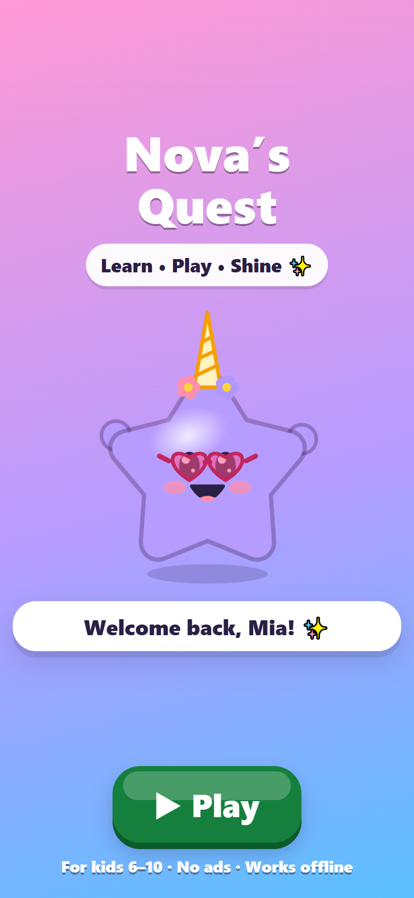
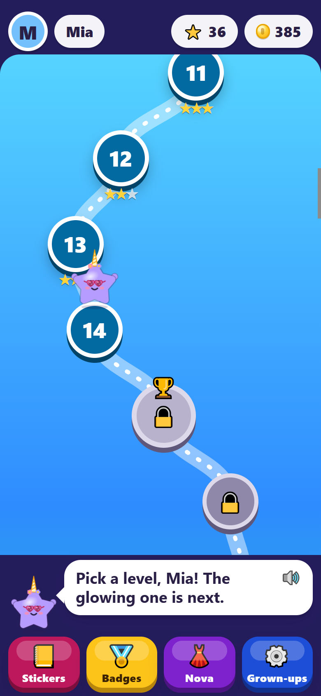
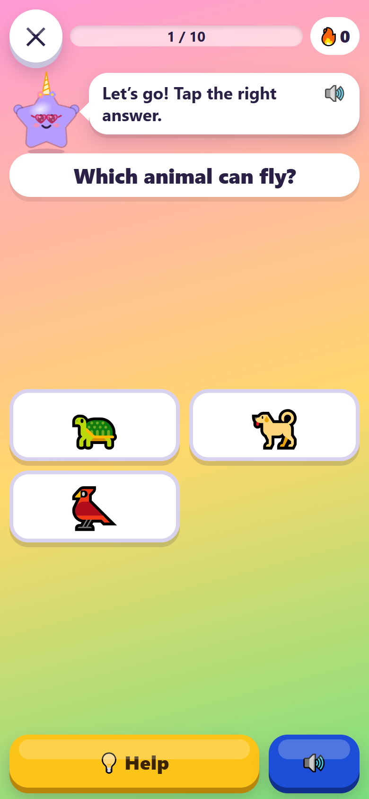
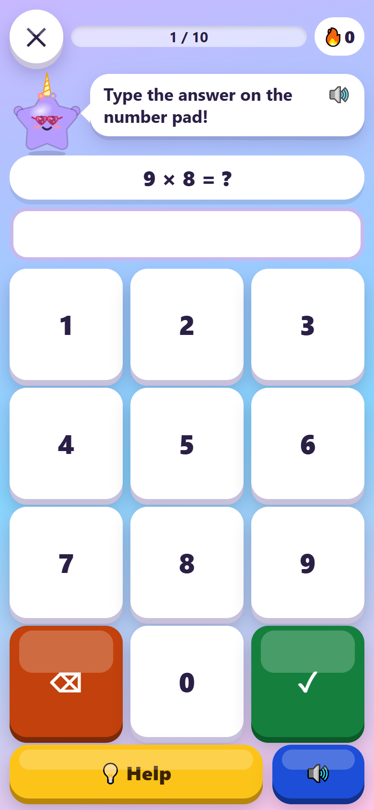
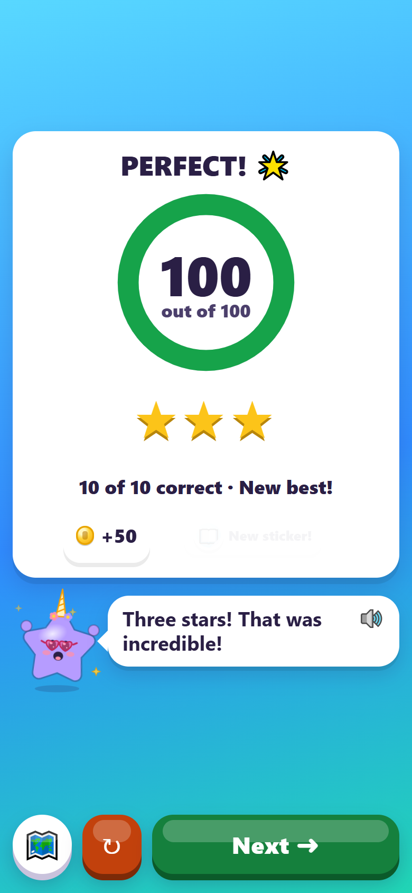
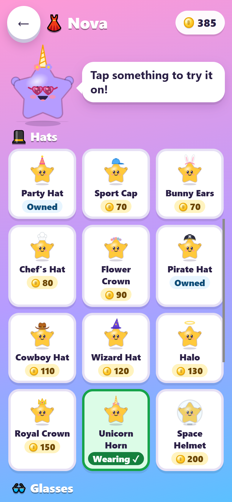

# Nova's Quest 🌟

A joyful learning game for children aged 6–10, built with plain HTML, CSS and JavaScript.
No frameworks, no build step, no network requests, no ads, no tracking.

**▶ Play it now: [novas-quest.vercel.app](https://novas-quest.vercel.app)** (best on a phone, and you can add it to your home screen)

<table>
  <tr>
    <td align="center"><br><sub>Title screen</sub></td>
    <td align="center"><br><sub>World map</sub></td>
    <td align="center"><br><sub>Picture questions</sub></td>
  </tr>
  <tr>
    <td align="center"><br><sub>Number pad for maths</sub></td>
    <td align="center"><br><sub>Stars and coins</sub></td>
    <td align="center"><br><sub>Dress up Nova</sub></td>
  </tr>
</table>

- 5 worlds × 10 levels = **50 levels** (every 5th level is a 15-question 🏆 TEST)
- 8 question types: multiple choice, true/false, counting, patterns, drag-to-order, match pairs, memory flip, and a number pad
- Nova the star mascot (inline SVG) gives hints, explains mistakes and celebrates wins
- Coins, stars, 55 stickers, 16 badges, a dressing room with 29 items, and a daily gift
- Sounds and music are generated in code (Web Audio), with an optional 🔊 read-aloud button
- Saves progress on the device (`localStorage` key `kidsquest_save_v1`) and works offline as a PWA

---

## How to run

### Option 1: just open it
Double-click `index.html`. Everything works from `file://` except the offline install (service worker), which needs http.

### Option 2: on your phone with VS Code "Live Server" (same Wi-Fi)
1. In VS Code, install the **Live Server** extension (by Ritwick Dey).
2. Open the `kidsquest` folder, right-click `index.html` and choose **Open with Live Server**.
3. Find your computer's local IP address. On Windows, run `ipconfig` and look for "IPv4 Address", e.g. `192.168.1.23`.
4. On your phone (on the same Wi-Fi), open `http://192.168.1.23:5500/index.html`.
   If it doesn't load, allow VS Code/Node through the Windows firewall for **private** networks.

Any other static server works too, for example `npx serve .` or `python -m http.server 8000`.

### Option 3: free hosting on GitHub Pages (works anywhere, installable, offline)
1. Create a new GitHub repository and upload the contents of this folder (`index.html` must be at the root).
2. Go to **Settings → Pages → Build and deployment**, choose **Deploy from a branch**, then `main` / `root`, and save.
3. After a minute, open `https://<your-user>.github.io/<repo>/` on your phone.
4. Tap **Share → Add to Home Screen** (iPhone) or **⋮ → Install app** (Android). It then opens full-screen in portrait and plays offline.

> After you change any file, bump `VERSION` in `sw.js` (e.g. `kidsquest-v2`) so installed copies pick up the update.

---

## Project structure

```
index.html        App shell, viewport meta, rotate-your-phone overlay
css/style.css     9:16 stage, world themes, buttons, animations, reduced motion
js/state.js       Save/load, scoring, unlocking, coins, stickers, badges, daily gift
js/audio.js       Web Audio sound effects, looping music, speechSynthesis
js/effects.js     Confetti and particle bursts (canvas), haptics, count-up
js/mascot.js      Nova SVG, expressions, dressing-room items, all phrases
js/levels.js      ALL content: worlds, levels, question pools and math generators
js/questions.js   Renderers for the 8 question types
js/main.js        Screen router and every screen
manifest.json     PWA manifest (portrait, SVG icons)
sw.js             Service worker (cache-first offline play)
icons/            SVG app icons
```

Scripts are plain `<script>` tags, not ES modules, so the game also runs from `file://`.

---

## How to add or change questions

Everything is in `js/levels.js`. Find a level in the `RAW` list and add a line to its `pool`:

```js
mc('What color is a lime?', 'Green 🟢', ['Red 🔴', 'Blue 🔵', 'Pink 🌸'], 'Limes are green and sour!', { v: '🍈' }),
tf('A spider has 8 legs.', true, 'Count them: spiders have 8 legs.'),
count('🍎', 'apples', 7),
pat(['🔴', '🔵', '🔴', '🔵'], '🔴', ['🔵', '🟢', '🟡'], 'Red and blue take turns.'),
ord('Put the numbers in order, smallest first', ['2', '5', '9'], 'Two, five, nine.'),            // items in the CORRECT order
match('Match the opposites', [['Hot', 'Cold'], ['Up', 'Down'], ['Big', 'Small']], 'Opposites!'),
mem('Find the pairs!', [['cat', '🐱'], ['dog', '🐶'], ['sun', '☀️']], 'Words and pictures!'),
inp('7 + 5 = ?', 12, '7 + 5 = 12.'),                                                            // number pad
```

Rules:
- Give **exactly one** correct answer, and give `mc` and `pat` **3 wrong answers** (levels 15 and up show 4 options).
- Every question needs a **kind, one-sentence explanation**. Nova shows it after a mistake.
- Optional visuals: `{ v: '🍌' }` (big emoji), `{ clock: '3:30' }` (analog clock), `{ frac: [1, 4] }` (shaded pie).
- Quizzes need at least 15 questions in the pool (pool plus `gen()`), and tests draw from the levels listed in `from`.
- Math levels have a `gen()` function that creates fresh, always-correct questions for every attempt.

Difficulty settings are at the bottom of `levels.js`:
`choicesFor` (2 → 3 → 4 options), `matchPairsFor`, `memPairsFor` and `timerFor` (timers only from level 31, and parents can switch them off).

---

## Game rules (for grown-ups)

| Thing | Rule |
|---|---|
| Score | `round(correct / total × 100)` |
| Pass | 80 or more unlocks the next level (8/10 on a quiz, 12/15 on a test) |
| Stars | ★ 80–89 · ★★ 90–99 · ★★★ 100. The best result is kept |
| Coins | 5 per correct answer, +2 during a streak of 3 or more, +10 for passing, +25 for 3 stars, +25 daily gift |
| Hints | 1 per question (💡 Help) |
| Timers | From level 31 only, 30–45 s per question (×1.6 for drag/match/memory/number pad), can be turned off |

**Settings** sit behind a parental gate (hold the button for 3 seconds). They include sound, music, read-aloud, timers, the player name and a reset with double confirmation.

**Privacy:** only a first name is stored, and only in this browser's `localStorage`. There are no network requests, accounts, ads, links or purchases.

---

## Testing shortcuts (for developers)

Open with a hash to jump straight to a screen. Results from `level` mode are **not** saved:

```
index.html#dev=level:27     play level 27
index.html#dev=intro:45     level intro
index.html#dev=results:12:9 results screen for 9 correct
index.html#dev=map | album | badges | shop | settings | setup
```

From the browser console, `KQ.App`, `KQ.State` and `KQ.Levels.buildQuiz(n)` are available.
To reset everything: `localStorage.removeItem('kidsquest_save_v1')`.

## Fonts
The font stack prefers rounded fonts already installed on the device ("Baloo 2", "Comic Neue", "Nunito", SF Rounded) and falls back to the system UI font.
To bundle a font, put e.g. `fonts/Baloo2.woff2` in the project and add `url('../fonts/Baloo2.woff2')` to the `@font-face` in `css/style.css`. Also add the file to `FILES` in `sw.js`.
